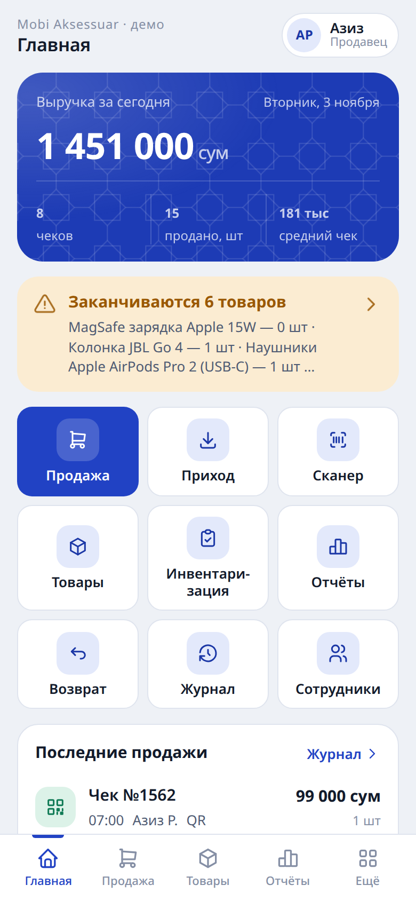
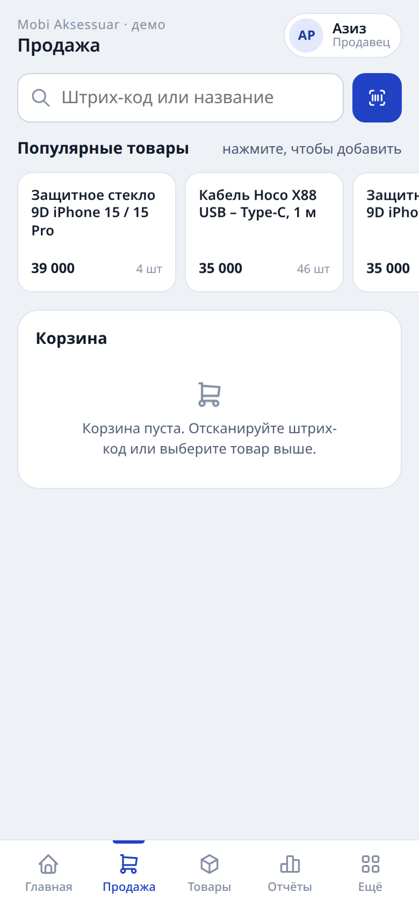
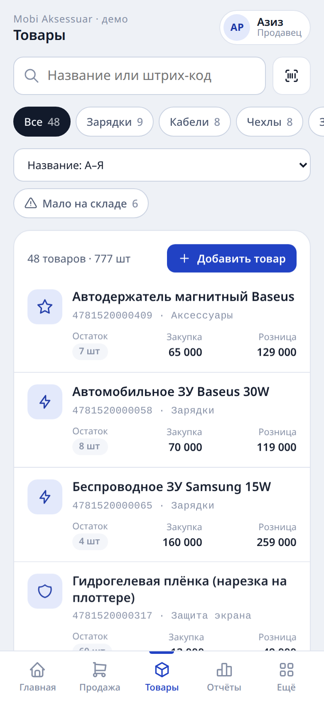
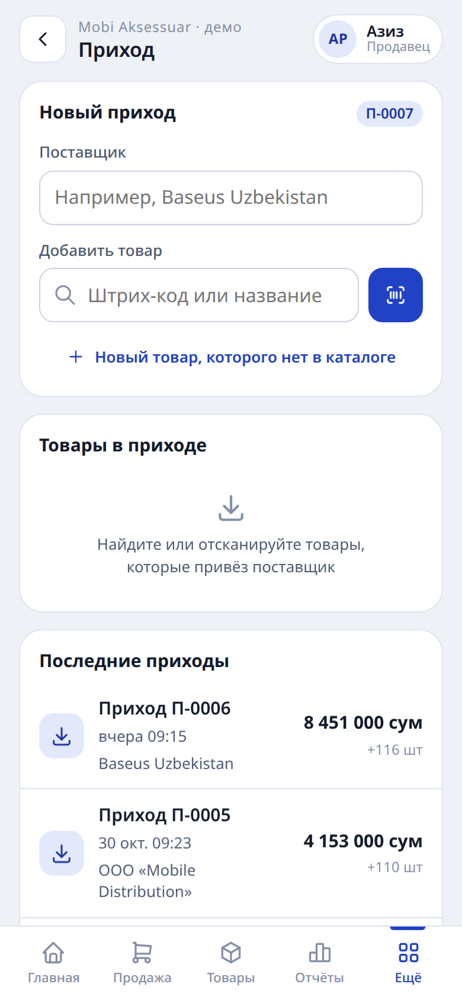
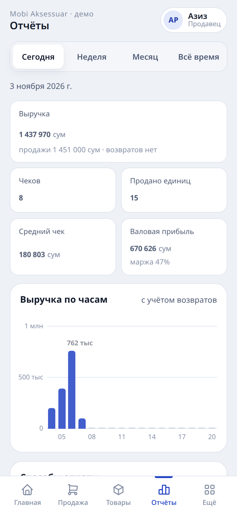
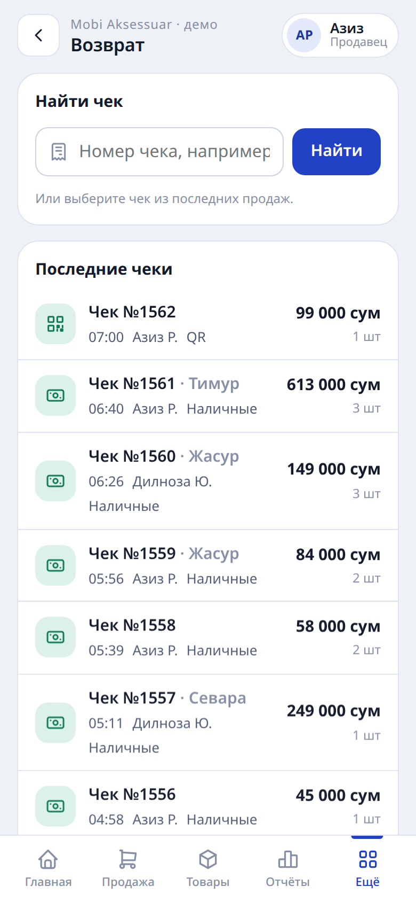

# Касса и склад

Веб-приложение для кассовых операций и складского учёта в розничном магазине аксессуаров для телефонов. Рабочее место продавца, каталог товаров, движение остатков и отчётность объединены в одном интерфейсе, адаптированном для смартфона и планшета.

**Демонстрационная версия:** https://asadbek8364-oss.github.io/kassa-demo/
Статичная сборка с предзаполненными тестовыми данными. Открывается в браузере, установка и регистрация не требуются.

## Скриншоты

| Главная | Продажа | Товары |
|---|---|---|
|  |  |  |

| Приход | Отчёты | Возврат |
|---|---|---|
|  |  |  |

## Функциональность

- **Продажи.** Оформление чека: поиск товара по названию или штрих-коду, сканирование штрих-кода камерой устройства. Способы оплаты: наличные, банковская карта, QR. Возврат оформляется по ранее выданному чеку, товар автоматически возвращается на остаток.
- **Каталог и остатки.** Номенклатура с ценами и текущими остатками. Списание при продаже и оприходование при приёмке выполняются автоматически. Товары с остатком ниже установленного порога выделяются на главном экране.
- **Приход.** Регистрация поставок: поставщик, перечень товаров, количество. Остатки обновляются в момент проведения документа.
- **Инвентаризация.** Сверка учётных остатков с фактическими, фиксация и протокол расхождений.
- **Отчётность.** Выручка за день и за выбранный период, количество чеков, средний чек, продажи в разрезе товаров.
- **Журнал операций.** Хронология всех действий в системе с указанием сотрудника и времени: продажи, приходы, возвраты, инвентаризации.
- **Сотрудники и разграничение доступа.** Роли «владелец» и «продавец»; операции каждого сотрудника учитываются отдельно.

## Демонстрационная и рабочая версии

Демонстрационная версия предназначена для ознакомления с интерфейсом: данные предзаполнены и хранятся локально в браузере, серверная часть не задействована.

Рабочая версия использует серверную базу данных: каталог, остатки и история операций едины для всех сотрудников и устройств магазина, доступ выполняется по персональному PIN-коду. Валюта учёта в демонстрационных данных — узбекский сум.
